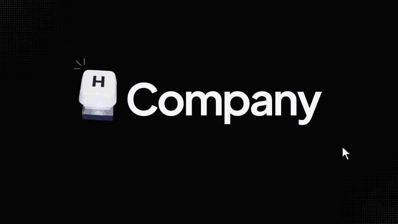

# H Companion

**A voice-first computer-use companion that lives inside the software you already use.** Hold a key, say what
you need, and H Companion shows you how on your own screen (red-pencil notes and circles drawn over the real
interface, read aloud), or does it for you while you watch. Every result is checked in the software itself, and
anything it cannot solve goes to the vendor's support as a complete, structured case.

Built on [H Company](https://hcompany.ai/)'s Holo models and H Agents API (computer use) during the H Company
computer-use hackathon.



---

## What it does

- **Ask by voice.** Push-to-talk (hold the shortcut, speak, release). Speech is transcribed (Gladia), then routed
  to a known procedure or to a general task by a Holo model.
- **Three levels of autonomy**, changeable at any time, even mid-task:
  - *Show me*: the assistant points at each control and explains; you click, it never takes the controls.
  - *Help if I'm stuck*: it guides you, and finishes the task itself (narrating each action) if you are stuck.
  - *Do it, I watch*: it does the task in front of you through H computer use, annotating every action.
- **On-screen guidance** in a hand-drawn style: a transparent overlay (macOS) frames the exact control found by
  Holo on a fresh screenshot, with a short handwritten note. The overlay is excluded from screen capture, so the
  model never sees its own marks.
- **Spoken notes** (ElevenLabs): each note is read aloud as it is drawn; the voice stops as soon as you act or
  speak.
- **Verified results.** Success means the expected end state is observed on screen by a separate read-only check,
  not that the agent said it was done. The report keeps three things apart: what the user declared, what the
  agent declared, and what was observed.
- **Safe by design.** Nothing runs before approval (a spoken request counts as approval in voice mode), Stop is
  local-first (no new command leaves the machine) and then cancels the remote session; simulated runs are always
  flagged as such.
- **Support side.** Reports go to a support backend: an authenticated dashboard with a timeline per case,
  grouping of similar difficulties, reliability metrics on real sessions only, a printable escalation file with
  the exact blocker and the decision expected from support, and optional automatic bug-fix pull requests through
  Devin (Cognition) for suspected product defects on allowlisted repositories.
- **Desktop app.** A small window (Electron) next to your work: live status and Stop, the autonomy slider, your
  task history with a ✓ / ✗ verdict per task (sent back with the report), voice and push-to-talk settings, and
  gaze calibration.
- **Vision (research).** A webcam gaze tracker (WebGazer + MediaPipe, entirely local: no face image leaves the
  computer) and a "honeycomb" heatmap that turns the noisy gaze plus the clickable elements on screen into a
  probability of where the user is about to act. Goal: send the model a crop around where the user looks instead
  of the whole screen, with a fallback to the full screen.

Demo software: Odoo CRM (create an opportunity, schedule a follow-up, log a note, qualify an opportunity, and a
deliberately blocked action caused by user rights) and the H Company platform (find documentation, create an API
key, redeem credits, create an agent, review a session, run a cloud session). Unscripted requests are handled by
the general agent working from the live page.

## How it works

```
 voice ──► transcription ──► routing (Holo) ──► guide  (Holo locates each control, overlay + voice, user acts)
 (push-to-talk)                              └► act    (H Agents API drives mouse/keyboard, narrated on screen)
                                                   │
                         read-only verification ◄──┘   (separate H session: is the end state really there?)
                                                   │
             runs/<session>/report.json ──► support backend ──► dashboard · grouping · escalation file · Devin fix
                                                   ▲
                        desktop app ◄── control point 127.0.0.1:8768 (status, autonomy, stop, voice, rating)
```

## Repository layout

| Path | What it is | Stack |
| --- | --- | --- |
| [`agent/`](agent/) | The assistant: procedures, routing, guide and act modes, verification, report, push-to-talk, overlay, voice, local control point (`hcs-agent`) | Python 3.12, `hai-agents`, AppKit (macOS) |
| [`backend/`](backend/) | Support backend: case ingestion, dashboard, grouping, metrics, escalation file, Devin auto-fix, Stripe test checkout (`hcs-backend`) | Python 3.12, FastAPI, SQLite |
| [`desktop/`](desktop/) | Desktop app (status, autonomy, activity and verdicts, voice, vision), macOS menu-bar companion and Finder launcher | Electron, plain JS |
| [`app/`](app/) | Vision Lab (local gaze tracking, calibration, region of interest, clean screen capture, Holo analysis) and the voice pilot UI | Electron, React, Vite, TypeScript |
| [`pilot/`](pilot/) | Voice pilot server and isolated headless-browser pilot | Python |
| [`heatmap/`](heatmap/) | Gaze "honeycomb" heatmap module and its test page | JS (no dependency) |
| [`landing/`](landing/) | The public website (landing page) | Static HTML/CSS/JS, three.js |
| [`contracts/`](contracts/) | JSON Schemas shared by every component, generated from `agent/src/hcs_agent/contract.py` | JSON Schema |
| [`scripts/`](scripts/) | Contract export, demo data reset (Odoo), procedure drafting, launchers, benchmarks | Python |
| [`docs/`](docs/) | Product spec ([PRD.md](PRD.md)), gaze research protocol, scenarios, test logs | Markdown |

## Requirements

- **macOS 14+** for the full assistant (overlay, screen capture, global push-to-talk). The support backend, the
  desktop app with a simulated agent, the website and every test also run on Linux.
- **Python ≥ 3.12** and [uv](https://docs.astral.sh/uv/).
- **Node.js ≥ 20** and npm (the Vision Lab is developed with Node 26).
- **Xcode Command Line Tools** for the Vision Lab's native screen-capture helper (`xcode-select --install`).
- **Google Chrome** for the isolated browser pilot only.
- API keys, all optional except H:

| Variable | Used for | Where |
| --- | --- | --- |
| `HAI_API_KEY` | **Required.** H Agents API and Models API (Holo). Or run `uv run holo login` | `.env` at the repo root (agent), `app/.env` (Vision Lab, pilot) |
| `GLADIA_API_KEY` | Speech-to-text for push-to-talk | `.env` |
| `ELEVENLABS_API_KEY` | Spoken notes (also read from `ELEVEN` in `backend/.env`) | `.env` |
| `LINKUP_API_KEY` | Documentation lookups (web search restricted to the vendor's docs when asked) | `.env` |
| `HCS_INGEST_TOKEN`, `HCS_DASHBOARD_PASSWORD` | Agent → backend uploads, dashboard login (generated and printed if empty) | `backend/.env` |
| `STRIPE_SECRET_KEY` | Checkout on the website, **test keys only** (`sk_test_…`) | `backend/.env` |
| `DEVIN_API_KEY`, `DEVIN_ORG_ID`, `HCS_FIX_REPOS` | Automatic fix pull requests (allowlisted repositories only) | `backend/.env` |

All `.env` files are git-ignored; every one has a commented `.env.example` next to it.

## Install

```bash
git clone https://github.com/Tooom123/H-Company_Computer-Use_Hackathon.git h-companion
cd h-companion

uv sync --all-packages                 # one .venv at the root with the agent and the backend
cp .env.example .env                   # put HAI_API_KEY (and the optional keys) in it
cp backend/.env.example backend/.env   # support backend settings

npm ci --prefix desktop                # desktop app
npm ci --prefix app                    # Vision Lab (optional)
```

**macOS permissions.** The app that launches Python (Terminal, iTerm, Ghostty…) needs **Screen Recording**,
**Accessibility**, **Input Monitoring** and **Microphone** in System Settings → Privacy & Security. Grants apply
to a freshly started app. `uv run holo doctor` checks the H side.

## Run

### 1. The assistant (macOS)

```bash
export HCS_PTT_KEY=ctrl+shift+h        # push-to-talk shortcut (or cmd+j, alt_r, f9)
uv run hcs-agent talk                  # the voice loop: hold the shortcut, speak, release
```

Other commands:

```bash
uv run hcs-agent procedures            # list the scripted procedures
uv run hcs-agent run --mode guide --procedure odoo_crm_create_opportunity \
    --goal "Create the Acme Demo opportunity" -p opportunity="Acme Demo"
uv run hcs-agent run -y --mode act --procedure odoo_crm_log_note --goal "Log a call" -p opportunity="Acme Demo"
uv run hcs-agent run --mock -y --procedure odoo_crm_change_stage_restricted --goal "Mark Acme Demo as won"
uv run hcs-agent serve [--mock]        # local HTTP/WebSocket API on 127.0.0.1:8765
uv run hcs-agent cleanup               # close orphaned H sessions that hold concurrency slots
```

`--mock` (or `HCS_MOCK=1`) runs everything against a simulated H backend: no key, no desktop control, and every
event and report is flagged `simulated: true`. Reports are written to `runs/<session>/report.json`; to send them to
the support backend, set `HCS_BACKEND_URL=http://127.0.0.1:8766` and `HCS_INGEST_TOKEN` (same as the backend's).

### 2. The desktop app

```bash
npm start --prefix desktop             # connects to the assistant on 127.0.0.1:8768 by itself
```

On macOS, `Launch H Companion.command` (double-click in Finder) starts the menu-bar companion, and
`python3 scripts/install-macos-launcher.py` installs a local `H Companion.app` shortcut in `~/Applications`.
Details: [desktop/README.md](desktop/README.md).

### 3. The support backend and dashboard

```bash
.venv/bin/hcs-backend seed-demo --reset   # optional: 4 demo cases, flagged demo_data + simulated
.venv/bin/hcs-backend serve               # http://127.0.0.1:8766/dashboard (user "support")
.venv/bin/hcs-backend fix <case_id>       # ask Devin to fix the defect behind a case (allowlisted repos)
```

API, grouping rules and the escalation file: [backend/README.md](backend/README.md).

### 4. Vision Lab and gaze heatmap

```bash
cp app/.env.example app/.env && npm run dev --prefix app      # Vision Lab: calibration, gaze region, Holo analysis
python3 -m http.server 5174 --bind 127.0.0.1 --directory heatmap   # heatmap test page (mouse as the eyes)
```

[app/README.md](app/README.md) · [heatmap/README.md](heatmap/README.md) ·
[research protocol](docs/gaze-research-protocol.md).

### 5. Voice pilot and isolated browser pilot

See [pilot/README.md](pilot/README.md) and [docs/isolated-browser-pilot.md](docs/isolated-browser-pilot.md).

### 6. Website

```bash
python3 -m http.server 5173 --bind 127.0.0.1 --directory landing   # http://127.0.0.1:5173
```

Click the H key (or press `h`).

## Tests

```bash
uv run pytest                          # agent + backend (simulated backend, no key needed)
npm test --prefix desktop              # desktop app UI logic
npm test --prefix app                  # Vision Lab (vitest)
npm test --prefix heatmap              # heatmap maths
```

Tests never need an H key: they run against the simulated backend.

## Shared contract

A request carries `session_id, software, role, goal, procedure_id, parameters, mode, autonomy`. Commands are
`approve`, `stop`, `next`, `autonomy`, `feedback`. Events expose the state, each step, guidance, documentation
lookups, `needs_human` and `finished`. The report separates the agent's **declared** result from the **verified**
postcondition and carries `category`, `status`, `escalation`, `evidence`, `timings`, `cost_usd` and the user's
`feedback`. Source of truth: [`agent/src/hcs_agent/contract.py`](agent/src/hcs_agent/contract.py); JSON Schemas in
[`contracts/`](contracts/), regenerated with `uv run python scripts/export_contracts.py`.

## Privacy

- Gaze tracking runs locally in the browser engine; no image of the user's face is sent anywhere. Only screen
  regions go to the model.
- The overlay and the desktop app are excluded from screen capture.
- Screenshots reach support only when the evidence is marked shareable and the user allowed it.
- Keys stay in git-ignored `.env` files and are never sent to the desktop app's interface.
