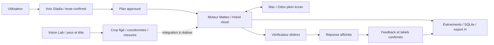

# H-Companion — récap équipe et passation

**État au 7 novembre 2026, 21 h 20, heure de Paris.** Pour Tom, Matteo et Édouard.
Ce document rapporte le code inspecté, les essais réalisés et les décisions de
travail. Les résultats sont des observations de développement, pas encore un
benchmark indépendant. Les tests continuent : cette page est un instantané.

## 1. Ce que nous construisons

**H-Companion est un assistant de support et d’onboarding qui intervient dans le
logiciel de l’utilisateur, avec son accord, et transforme l’intervention en
information exploitable pour l’éditeur.** L’utilisateur explique son besoin,
approuve un plan, observe l’aide et donne un retour sur le résultat et l’utilité.
Un échec doit produire une escalade documentée.

La proposition GTM est de distribuer H via les éditeurs de logiciels : chacun
pourrait fournir sa documentation, ses procédures et son contexte métier, puis
proposer Companion à ses utilisateurs. Les usages envisagés comprennent onboarding
par persona, découverte de fonctionnalités, configuration, support, remontée de
bugs et feedback produit. Suggestions commerciales et échanges entre agents A2A
restent des extensions possibles. Notre premier utilisateur n’a pas besoin de
posséder son propre agent.

Deux chantiers se complètent :

- **Le produit :** voix → intervention Holo → vérification → feedback → support.
- **La recherche :** sélectionner une région d’écran à partir des yeux et de la
  tête, afin de tester une réduction des données visuelles et de la latence.

La documentation Markdown avec recherche hybride/RAG est une cible d’architecture.
Le pilote actuel utilise des procédures YAML explicites ; il n’intègre pas encore
un RAG hybride alimenté par toute la documentation d’un éditeur.

## 2. Ce qui fonctionne aujourd’hui et ce qui reste séparé

| Élément | État observé |
| --- | --- |
| Vision Lab Electron sur Mac | Capture, calibration, suivi yeux/tête, sélection de région, aperçu exact et diagnostics disponibles |
| Politique tête à cinq zones | Implémentée ; un essai humain encourageant, détaillé ci-dessous |
| Test automatique à cible rouge | Parcours reproductible, couverture, replis, surface et revue des captures |
| Pilote vocal Electron | Demande dictée avec Gladia, correction du texte, approbation, exécution et feedback sauvegardé |
| Moteur de Matteo dans le pilote | Révision épinglée, Holo4-35B-A3B cloud, mode `act`, captures plein écran |
| Stockage de Tom dans le pilote | Événements et rapports en SQLite, plus épisodes et archives privés |
| Odoo 20 de démonstration | Instance dédiée déployée sur Netcup, données fictives, parcours manuel préparé et testé |
| Scénarios Odoo | Dix préparés ; 01, 02 et 03 réalisés avec le pilote, avec résultats et limites ci-dessous |
| Scénarios H Company | Dix préparés ; pas encore exécutés dans cette campagne |
| Inférence Holo4 sur DGX Spark | Serveur existant testé en texte et image ; pas encore raccordé au pilote vocal |
| Crops Vision Lab → moteur autonome | **Pas encore intégré** ; aucun gain du Lab ne doit être attribué aux essais Odoo actuels |
| LoRA et benchmark base/adaptateur | Protocole préparé ; aucun adaptateur entraîné ou évalué à ce stade |



La voix est actuellement une **entrée** : la réponse du pilote s’affiche à l’écran.
Il n’y a pas encore de synthèse vocale dans ce parcours. Les nouvelles narrations
présentes dans la branche de Matteo ne sont pas automatiquement actives dans le
pilote épinglé.

## 3. Où est le code ? Attention aux versions

Le `main` observé avant publication de ce récap est le socle `84e2b83`.
**Ajouter ce document sur `main` ne fusionne pas les fonctionnalités.** Pour
reproduire le pilote ou le Lab, consulter les versions indiquées, puis intégrer
les changements de façon explicite.

| Branche / composant | Révision inspectée | À retenir |
| --- | --- | --- |
| `edouard/gaze-desktop` | `8e233f6` | Lab, scénarios, pilote vocal, archives, réponse visible et réparation des canaux bureau périmés |
| Moteur réellement chargé par le pilote | Matteo `343e393` | Le lanceur extrait cette révision ; un `fetch` ne change pas le moteur en cours |
| Backend réellement chargé par le pilote | Tom `bd3b2ca` | Stockage support utilisé par ce pilote |
| `matteo` | `523edc4` | Avancées supplémentaires : guidage/prise de contrôle, overlays et narration ; dernières corrections du raccourci de pause et de l’interface |
| `integration` | `7d5abf6` | Intègre une version antérieure du pilote et des travaux Tom ; ne contient pas encore les correctifs Édouard `9103380` et `8e233f6` |
| `feature/tom-devin-autofix` | `9afed4f` | Code candidat de correction via Devin ; fonctionnement de bout en bout non vérifié dans cette séance |

Au dernier fetch, `integration` ne contient pas non plus les trois commits Matteo
`7b3cc73`, `0c098fb`, `523edc4`. Les branches Tom de landing page, heatmap et
transmission au support existent ; présence du code et validation de la démo
commune sont deux étapes distinctes.

Points d’entrée, épinglés pour rester lisibles même depuis `main` :

- [Pilote vocal : installation, lancement et limites](https://github.com/Tooom123/H-Company_Computer-Use_Hackathon/blob/8e233f6/pilot/README.md).
- [Code et interface du Lab](https://github.com/Tooom123/H-Company_Computer-Use_Hackathon/tree/8e233f6/app).
- [Dernière branche Matteo inspectée](https://github.com/Tooom123/H-Company_Computer-Use_Hackathon/tree/523edc4).
- [Journal détaillé des essais](https://github.com/Tooom123/H-Company_Computer-Use_Hackathon/blob/8e233f6/docs/test-log.md).
- [Protocole Lab → Odoo → LoRA](https://github.com/Tooom123/H-Company_Computer-Use_Hackathon/blob/8e233f6/docs/lab-to-odoo-lora.md).

## 4. Vision Lab : ce que nous avons appris

### Du point précis aux zones stables

Le suivi WebGazer seul était insuffisamment précis sur les premiers essais.
L’ajout de l’orientation de la tête a amélioré l’expérience rapportée par Édouard.
Cependant, projeter chaque pose de tête vers un point précis provoquait beaucoup
de replis plein écran : prédiction hors écran ou orientation hors calibration.

Nous avons donc ajouté une politique **centre + quatre coins** : zone centrale
neutre, rectangle ancré dans un coin lorsque la tête s’oriente dans cette direction,
et confirmation du changement pendant 250 ms. En mode fenêtre, la sélection
centrale peut utiliser les limites de la fenêtre visible au centre. Les régions
peuvent se chevaucher ; ce ne sont pas cinq tuiles égales et disjointes.

Le Lab dispose aussi d’une calibration à bords étendus, de validations distinctes,
du masquage du panneau pendant l’observation, d’un contour optionnel et d’un test
à cible rouge. Le sélecteur ne reçoit pas la position de la cible de test. Le score
reste calculé sur toutes les captures, même lorsque des images sont retirées de
la revue pour respecter la limite mémoire.

### Dernier essai rapporté par Édouard

Configuration : **Tête · cinq zones**, calibration **Bords étendus**, parcours
**42**, **30 secondes**, région demandée **800 × 600**, écran **1470 × 956**.

| Mesure | Résultat |
| --- | --- |
| Captures analysées / évaluables | 30 / 23 ; 7 exclues, notamment pendant la stabilisation |
| Centre de la cible inclus | 23 / 23 — **100 %** |
| Cible entière, toutes captures évaluables | 20 / 23 — **87 %** |
| Cible entière, captures recadrées seules | 18 / 21 — **86 %** |
| Replis plein écran | 2 / 30 — **7 %** |
| Surface détaillée conservée, moyenne évaluée | **40 %** de l’écran ; aperçu global non compté |
| Cible entière aux bords / à l’intérieur | 14 / 17 — 82 % ; 6 / 6 — 100 % |

Les deux replis proviennent d’une orientation au-delà de la plage élargie et d’un
changement de direction encore en stabilisation. Le précédent essai présentait
14 replis sur 30. Cette comparaison est descriptive : les conditions de calibration
ont changé et toutes les anciennes dimensions ne sont pas établies.

**Conclusion : la sélection grossière est une piste crédible à poursuivre.**
Mais 40 % de surface conservée ne signifie pas 60 % de tokens économisés. Aucun
appel Holo n’a mesuré cette économie pendant l’essai à cible rouge. Trois cibles
évaluables étaient partiellement coupées malgré leur centre inclus : un centre
correct ne garantit pas la lisibilité du bouton ou du contexte métier.

Prochain contrôle : répéter avec des parcours inédits, mêmes dimensions et même
calibration, puis comparer plein écran / crop / crop + aperçu sur les mêmes images
Odoo figées. Mesurer `usage` réellement retourné, durée totale, bonne réponse et
recours au plein écran, en comptant aperçus et relances. Une fenêtre maximisée
peut donner peu d’économie : c’est un résultat à conserver, pas à masquer.

## 5. Odoo : environnement et premiers résultats

La démo utilise une société fictive Odoo 20 dédiée sur Netcup. Sur le Mac préparé,
le tunnel donne accès à `http://holo.localhost:18090/web/login`. Cette adresse est
locale au poste ; elle n’est pas une URL publique utilisable par tous.

État de référence après reset : Gingembre **10 unités**, Pomme **8**, Hibiscus
**6** ; prix de vente Gingembre **10 €**. Le parcours d’achat consiste à commander
6 unités à 4 €, recevoir 4 puis les 2 restantes : montant 24 €, stock 10 → 14 → 16.
Le déploiement et ce parcours ont été validés manuellement par l’agent chargé
d’Odoo. Cela ne valide pas encore leur réalisation autonome par H-Companion.

### Passages du pilote vocal

Durées ci-dessous : intervalle approbation → fin d’intervention, pas le temps
complet incluant dictée et feedback. Résultats relus à 21 h 20.

| Cas / tentative | Résultat moteur | Retour utilisateur | Archive |
| --- | --- | --- | --- |
| 01 — prix et stock | Résolu en **33,4 s**, 4 critères validés, 10 € / 10 unités | Réussite partielle ; utilité non évaluée, réponse finale insuffisamment visible | Complète |
| 02 — comparer les stocks | Résolu en **81,7 s**, 4 critères validés, Hibiscus le plus faible | Réussite partielle ; utilité non évaluée, même problème de restitution | Complète |
| 03 — fournisseur, tentative 1 | Interrompue après **134,7 s**, canal bureau périmé | Labels inconnus ; commentaire d’échec conservé | Partielle |
| 03 — fournisseur, tentative 2 | Interrompue après **132,8 s**, même problème de canal | Labels inconnus | Partielle |
| 03 — fournisseur, après correctif | **Résolu en 52,1 s**, 3 critères validés ; fiche ouverte et adresse fictive retrouvée | **Réussie et utile**, commentaire « nickel », enregistré à 21 h 18 | **Complète** |

Un brouillon supplémentaire non approuvé a été fermé pendant le redémarrage : il
ne compte pas comme une exécution H. Les échecs restent dans les données ; une
nouvelle tentative ne remplace pas l’épisode précédent.

Avant le pilote vocal, un premier parcours technique de lecture produit avait
abouti en **26,4 s**, après des essais interrompus et deux corrections de procédure
ou de vérification. Ces passages ont aidé à développer le produit ; ils ne sont
pas des répétitions indépendantes d’un benchmark final.

### Deux corrections déterminantes

1. **Restitution :** réponse finale mise en évidence dans le panneau. La réussite
   du vérificateur n’implique pas que l’utilisateur ait vu ou compris le résultat.
2. **Liaison bureau :** le pilote réutilisait un canal H terminé. L’adaptateur
   `pilot-bridge-health-v1` contrôle l’état du canal et du bridge avant réutilisation,
   recrée sa propre liaison si nécessaire et expose les erreurs de connexion.
   Le dernier cas 03 est un premier passage réel réussi après redémarrage avec
   cet adaptateur. La récupération automatique d’un futur canal périmé, sans
   redémarrage, reste à confirmer ; la fiabilité sur une longue série aussi.

Les contrôles automatisés du pilote, de l’adaptateur et de l’interface sont passés
sur la branche de travail. Les permissions macOS et la disponibilité d’un bureau
visible restent des conditions de test réel. Une demande d’arrêt n’est pas une
confirmation d’arrêt : attendre le retour du moteur avant de reprendre le Mac.

### Les dix scénarios à poursuivre

| Odoo | Demande / objectif |
| --- | --- |
| 01 | Retrouver Gingembre, lire prix et stock sans modification |
| 02 | Comparer les trois stocks et identifier le plus faible |
| 03 | Ouvrir Fournisseur Holo Démo et lire son e-mail sans envoyer de message |
| 04 | Chercher `HACK-INCONNU-999` et expliquer l’absence sans créer de produit |
| 05 | Préparer le brouillon d’achat : 6 Gingembre à 4 €, sans confirmer |
| 06 | Confirmer ce brouillon, sans réceptionner |
| 07 | Réceptionner 4 unités et conserver un reliquat de 2 |
| 08 | Expliquer les réceptions et ouvrir le reliquat sans le valider |
| 09 | Réceptionner les 2 restantes depuis le reliquat existant |
| 10 | Vérifier montant, absence de doublon, deux réceptions liées et stocks finaux |

[Les phrases exactes à dicter et l’ordre de séance sont ici](https://github.com/Tooom123/H-Company_Computer-Use_Hackathon/blob/8e233f6/docs/scenarios/odoo-voice-session.md).
Les cas 05–10 partagent un `workflow_id` et une même référence de passage.
`HACK-RUN-003` a été réservée : vérifier son état avant de commencer, ne pas
réinitialiser la base ni recréer une commande au milieu du workflow.

Pour H Company, les dix cas préparés couvrent Quickstart, navigateur local,
permissions desktop, runtime local avec Spark, Skills, sortie structurée, erreurs
de quota, export des images/actions, revue d’une session Agent View et diagnostic
d’une session en échec. [Questions et critères détaillés](https://github.com/Tooom123/H-Company_Computer-Use_Hackathon/blob/8e233f6/docs/scenarios/h-company-scenarios.md).
H01–H08 sont des tâches de navigation documentaire ; H09–H10 nécessitent des
sessions de démonstration accessibles. La qualité de l’explication doit être relue
par un humain, au-delà de la vérification automatique de la page visible.

## 6. Traces, feedback et apprentissage : ce qui est réellement conservé

Le pilote relie demande brute et corrigée, scénario, plan approuvé, procédure,
révisions, modèle, événements, rapport, verdict du vérificateur et feedback humain.
La voix est transcrite avec Gladia dans la configuration testée ; le retour peut
aussi être saisi au clavier. Tous les feedbacks n’ont donc pas de fichier audio.

Dossier privé sur le Mac de test :
`~/Library/Application Support/HCompanionResearch/voice-pilot`.

| Emplacement | Contenu |
| --- | --- |
| `audio/` | Audio et transcriptions, lorsque la dictée a été utilisée |
| `episodes/<id>/` | Demande, procédure, événements, rapport, labels et captures locales |
| `archives/<id>/` | Export des sessions H, ressources téléchargées et état de complétude |
| `support.sqlite3` | Stockage des événements et rapports support |
| `runtime.json` | Révisions et configuration effective du pilote |

Nous gardons distincts **ce que l’agent annonce**, **ce que le vérificateur observe**,
**ce que l’utilisateur juge réussi**, **l’utilité**, et **l’autorisation d’entraînement**.
Le dernier cas 03 a un accord d’entraînement, mais `reviewed=false` et
`include_for_training=false` : l’accord ne remplace pas la revue de la trace.

**Décision actuelle : export H + archive locale ; Langfuse facultatif ensuite.**
Agent View aide à revoir les sessions cloud, mais notre dataset doit conserver
les octets des images et les événements, pas seulement des liens. Un export
complet n’est pas nécessairement une reproduction exacte de tout le contexte
d’inférence. Voir le [runbook de collecte](https://github.com/Tooom123/H-Company_Computer-Use_Hackathon/blob/8e233f6/docs/trace-capture-runbook.md)
et le [détail des exports et limites](https://github.com/Tooom123/H-Company_Computer-Use_Hackathon/blob/8e233f6/docs/scenarios/h-company-scenarios.md#traces-h-ou-langfuse-).

`ready_for_sft=false` reste la règle. Pour le SFT, il faut encore reconstituer
chaque paire observation/action avec image exacte, contexte documentaire,
instructions, outils, coordonnées et corrections. Un label final de réussite
ne prouve pas que toutes les actions intermédiaires sont de bons exemples.

Les archives, captures, audio, identifiants et secrets restent hors Git. Le repo
contient code, protocoles, scénarios et résultats agrégés.

## 7. Utiliser Holo sur le DGX Spark

### Serveur déjà présent : ne pas réinstaller

Le handoff local et l’audit SSH confirment ce serveur :

| Paramètre | Valeur |
| --- | --- |
| Machine | DGX Spark 128 Go ; alias SSH d’Édouard `dgx1` |
| Modèle chargé | **Holo4-35B-A3B-NVFP4** |
| Nom servi à envoyer dans `model` | **`holo4-35b-a3b`** |
| API sur le Spark | **`http://127.0.0.1:8011/v1`** |
| Serveur | vLLM 0.28.0 |
| Authentification | Clé vLLM dédiée ; obligatoire pour `/v1/models` et `/v1/chat/completions` |
| Autre port | **8010 = Holo3.1**, ne pas le confondre avec Holo4 |

Le handoff indique un contexte de 65 536 tokens et jusqu’à cinq images par requête.
Les poids et l’environnement existent dans `/home/dgx/dejabu-holo/`. Le fichier
privé `holo.env` y contient `VLLM_API_KEY` ; sa valeur ne doit pas être copiée ici.
Le service `holo.service` correspond à Holo3.1 : ne pas le redémarrer pour Holo4.

Deux contrôles antérieurs ont réussi : réponse texte en 0,128 s et lecture d’une
image Odoo fictive en 1,178 s, avec 1 077 tokens d’entrée et 50 de sortie pour cette
seconde requête. Ce sont des smoke tests ponctuels, pas une estimation du temps
d’une tâche complète ni une comparaison avec le cloud.

Le modèle quantifié dispose d’une fiche publique [Holo4-35B-A3B-NVFP4](https://huggingface.co/Hcompany/Holo4-35B-A3B-NVFP4).
L’API modèle auto-hébergée et la boucle agent sont des composants distincts :
[documentation H sur l’inférence locale](https://hub.hcompany.ai/agents-api/local-inference).

### Accès testé depuis le Mac d’Édouard

L’alias `dgx1` est une configuration locale. Il résout vers `spark-3a34`, utilisateur
`dgx` ; **la route SSH observée utilise Tailscale**. Copier simplement cet alias
sur une autre machine ne crée ni accès réseau ni autorisation SSH.

Pour exposer l’API uniquement sur le localhost du Mac, garder ce tunnel ouvert :

```sh
ssh -N -T -o ExitOnForwardFailure=yes -o ServerAliveInterval=30 \
  -L 127.0.0.1:18011:127.0.0.1:8011 dgx1
```

Le client utilise ensuite `http://127.0.0.1:18011/v1` et le modèle
`holo4-35b-a3b`. Le tunnel chiffre le transport ; il ne remplace pas la clé API.
La clé cloud H ne remplace pas non plus la clé vLLM. Le mécanisme utilisé est
le [transfert de port local OpenSSH](https://man.openbsd.org/ssh#L).

Exemple de client, après mise à disposition privée de la clé dans l’environnement
du terminal (`VLLM_API_KEY`), avec le paquet Python `openai` disponible :

```python
import os
from openai import OpenAI

client = OpenAI(
    base_url="http://127.0.0.1:18011/v1",
    api_key=os.environ["VLLM_API_KEY"],
)
response = client.chat.completions.create(
    model="holo4-35b-a3b",
    messages=[{"role": "user", "content": "Réponds seulement : HOLO4_OK"}],
    max_tokens=32,
    temperature=0,
    extra_body={"chat_template_kwargs": {"enable_thinking": False}},
)
print(response.choices[0].message.content)
print(response.usage)
```

### Sans Tailscale ? Une URL publique ?

**Sur le même réseau local que le Spark :** un accès SSH direct par son adresse
LAN est une option, après autorisation de la clé du teammate et vérification de
la connectivité. Ce trajet n’a pas encore été testé depuis un autre poste.
Demander l’adresse en privé, puis remplacer les paramètres entre chevrons :

```sh
ssh -N -T -o ExitOnForwardFailure=yes -o ServerAliveInterval=30 \
  -L 127.0.0.1:18011:127.0.0.1:8011 <compte>@<hote-dgx-accessible>
```

**À distance, sans Tailscale : pas encore d’URL Holo4 prête à utiliser.**
Une URL publique de proxy IA existe : `https://ai.edouardfoussier.com`. L’audit
observe un tunnel Cloudflare vers LiteLLM (`litellm:4000`), mais sa configuration
ne route **ni Holo4 ni le port 8011**. La requête anonyme `/v1/models` renvoie 403 ;
l’origine de ce refus n’a pas été qualifiée. Cette adresse ne doit donc pas être
annoncée comme l’endpoint Holo4 de l’équipe.

Une évolution possible serait de raccorder Holo4 au proxy HTTPS existant et de
créer un accès dédié pour l’équipe, puis de tester une vraie requête authentifiée.
**Aucun routage, droit d’accès ni service n’a été modifié pendant cet audit.**
L’écoute du serveur sur `0.0.0.0:8011` ne prouve pas une exposition Internet.

### Raccordement au produit : tâche encore ouverte

Le pilote vocal utilise aujourd’hui Agents API cloud. Ce n’est pas un simple
remplacement d’URL : il faut exécuter la boucle agent locale, relier le desktop
du Mac au serveur modèle Spark et enregistrer localement les traces.

Le SDK installé expose `Client.local` et `Inference.self_hosted`. Le passage de
l’authentification vLLM et la compatibilité outils/actions doivent encore être
validés. Une requête texte ou image réussie ne valide pas le contrôle d’Odoo.
Le [runtime local documenté par H](https://hub.hcompany.ai/agents-api/local-runtime)
est le point d’entrée de ce chantier. Aucun nouveau téléchargement de poids n’est
nécessaire pour commencer ces vérifications.

## 8. Fine-tuning : une suite possible, après la collecte propre

Ressources annoncées : Spark pour l’inférence, crédits Verda disponibles et accès
Colab. Aucun GPU supplémentaire n’a été réservé par cette tâche. Le budget seul
ne donne pas le temps d’entraînement : cela dépend du modèle entraînable retenu,
des résolutions, longueurs de séquences et du débit mesuré sur le GPU choisi.

Ordre proposé :

1. Obtenir **10–20 épisodes complets et relus**, y compris les échecs, avant de viser 100.
2. Réserver des variantes inédites et séparer les lots par workflow/session, pas
   par screenshot. Les étapes 05–10 d’un même achat doivent rester dans le même lot.
3. Tester d’abord la documentation/procédure et le recadrage sans entraînement.
4. Vérifier un petit entraînement LoRA et le chargement de son adaptateur avec
   l’architecture et le serveur retenus. Les poids NVFP4 déjà servis ne garantissent
   pas à eux seuls une chaîne de fine-tuning compatible.
5. Mesurer le débit sur quelques étapes avant d’annoncer une durée pour la nuit.
6. Comparer base et adaptateur sur le même **test tenu à l’écart de l’entraînement**,
   mêmes tâches, infrastructure, images et critères. Conserver aussi latence,
   coût, échecs, interventions et utilité utilisateur.

Nous ne pourrons pas attribuer un gain au LoRA si nous changeons simultanément
les procédures, le recadrage, le modèle et le matériel. Une dizaine de tâches
répétées peut fournir des traces utiles au développement, mais pas 100 exemples
indépendants ni une preuve de généralisation.

## 9. Répartition proposée et prochaine séquence

| Personne | Prochain chantier concret | Livrable attendu |
| --- | --- | --- |
| **Édouard** | Terminer 04 puis le workflow Odoo 05–10, observer les passages, dicter les retours et contrôler les états métier | Premier lot humain avec labels confirmés et archives contrôlées |
| **Matteo** | Intégrer le correctif de reconnexion, qualifier ses nouveaux commits, stabiliser arrêt/reprise ; ensuite runtime local Spark et raccordement des crops | Une version moteur épinglée qui enchaîne les scénarios et conserve les transformations de coordonnées |
| **Tom** | Consolider rapports/feedback dans le dashboard, rendre échecs et exports incomplets visibles, préparer revue et export du dataset | Tableau reliant scénario, tentatives, preuve, verdict, utilité, consentement et sélection pour entraînement |

Séquence immédiate :

1. Garder le pilote réparé pour finir le petit lot ; ne pas changer de moteur au
   milieu d’une série sans enregistrer la nouvelle version.
2. Relire les épisodes 01–03 et leurs archives, puis poursuivre Odoo. Un seul
   opérateur ou agent contrôle le Mac à la fois.
3. Intégrer les dernières branches avec une revue ciblée, puis refaire un test
   lecture seule, une interruption et une reprise avant les mutations métier.
4. Faire la première série H Company, puis répéter les essais Lab sur d’autres
   parcours et mesurer les vrais appels modèle.
5. Décider de l’entraînement après inspection d’un export image/action réimportable.

Pour démarrer un autre poste, suivre le guide du pilote lié plus haut : Python
≥ 3.12, `hai-agents[desktop]==1.4.3`, clés `HAI_API_KEY` et `GLADIA_API_KEY` privées,
permissions micro/capture/Accessibilité, serveur local puis Electron. Ne pas
copier les secrets ni les données privées dans le dépôt. Un redémarrage du serveur
renouvelle son token local : relancer aussi le client. Vision Lab et le pilote
peuvent utiliser deux applications de développement distinctes sur le Mac.

## 10. Sources de cet état

Ce récap s’appuie sur le code aux révisions indiquées, les rapports/labels locaux
du pilote, les retours d’Édouard, le journal du Lab et les deux passations Odoo/DGX
du 7 novembre. Les fichiers privés de passation se trouvent sur le Mac d’Édouard
dans `deja-bu/out/bruxelles-convergence/docs/` ; les accès sont transmis séparément.
L’audit DGX a été effectué en lecture seule. Le document ne contient ni clé,
audio, capture brute, adresse IP privée ni identifiant de session cloud.
